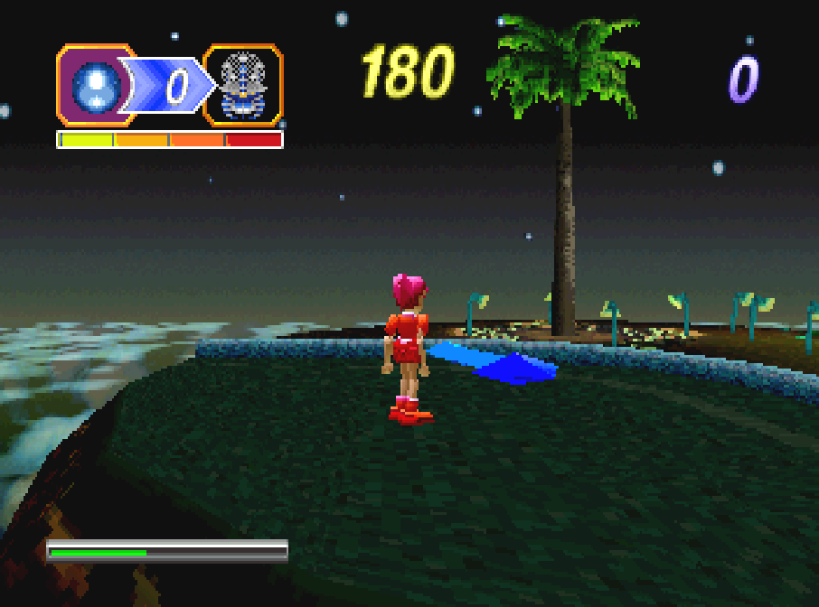

NiGHTS into Dreams - Twin Seeds Palm Tree Restoration v1.1
===========================================================

## Video Demonstration

WHAT IT DOES
Restores a palm tree to the empty planter in Twin Seeds, using Sega's unused artwork and NiGHTS' original camera-facing sprite renderer. The tree's placement and proportions are a fan reconstruction, not a confirmed original Sega layout. Collision is not included.

HOW IT WORKS
The patch reads both textures from your original game image, losslessly reorders the canopy's stored pixels, and uses Saturn hardware scaling. It adds one native tree actor that appears automatically in Twin Seeds. No game artwork or disc images are included; originals are never changed.

COMPATIBILITY
Only the verified NTSC version is supported at this time (single-BIN, 21-track BIN/CUE). PAL versions are not supported. Requires Windows and Python 3, with no extra Python packages. Tested in Mednafen and on an original Sega Saturn.

INSTALLATION
1. Extract these three files together.
2. Keep your original game BIN and CUE in the same folder. Drag the original NIGHTS.CUE onto Patch_NiGHTS_Palm.bat.
3. The patcher creates NIGHTS_PATCHED.BIN and NIGHTS_PATCHED.CUE next to your originals. Burn or load the patched CUE, not the BIN by itself.

You can keep the PATCHED names. To rename the output to NIGHTS.BIN and NIGHTS.CUE, first move the patched pair away from your originals, rename both files, and edit the CUE's FILE line to reference "NIGHTS.BIN" instead of "NIGHTS_PATCHED.BIN".

Inspired by GigglyMan's Twin Seeds palm tree mockup.

Unofficial fan restoration; not affiliated with Sega. Supply your own original game image.
